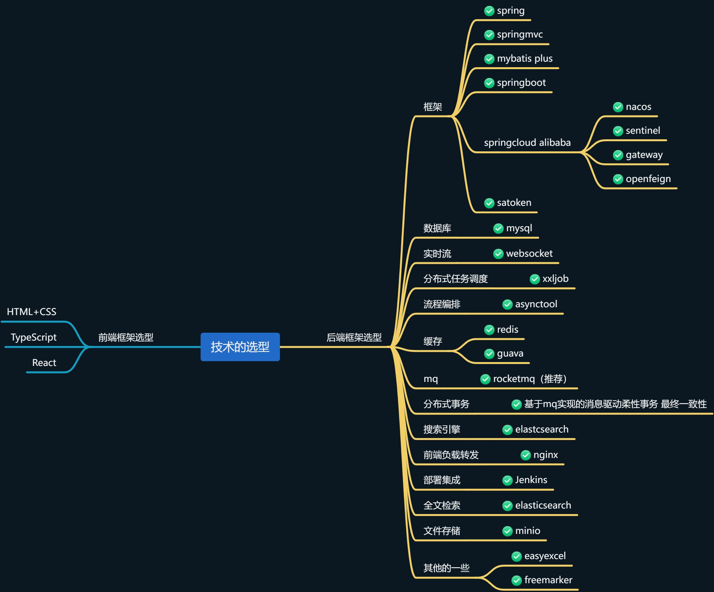
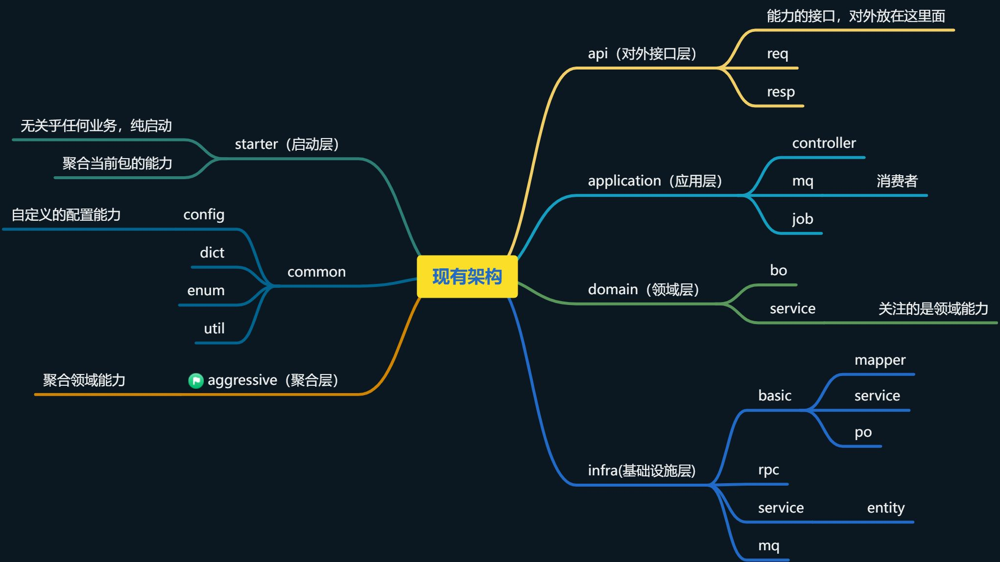
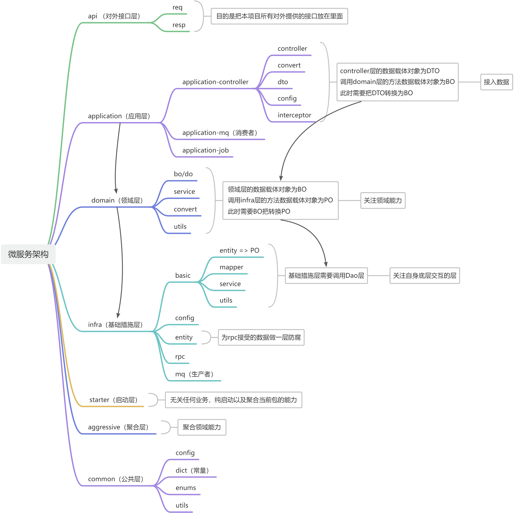
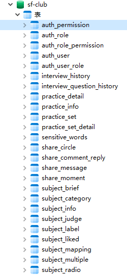

# 烤面筋 (sf-club) 🚀

<p align="center">
  <strong>专为程序员打造的高并发、一站式面试刷题与技术交流微服务社区</strong>
</p>

<p align="center">
  <a href="https://www.oracle.com/java/technologies/javase/javase-jdk8-downloads.html"></a>
  <a href="https://spring.io/projects/spring-boot"></a>
  <a href="https://spring.io/projects/spring-cloud"></a>
  <a href="https://github.com/alibaba/spring-cloud-alibaba"></a>
  <a href="https://sa-token.cc/"></a>
  <a href="https://rocketmq.apache.org/"></a>
  <a href="https://www.elastic.co/"></a>
  <a href="https://github.com/langchain4j/langchain4j"></a>
  <a href="./LICENSE"></a>
</p>

---

## 📑 目录

- [项目简介](#-项目简介)
- [核心业务功能](#-核心业务功能)
- [系统架构与 DDD 实践](#-系统架构与-ddd-实践)
- [技术选型清单](#-技术选型清单)
- [微服务模块划分与端口映射](#-微服务模块划分与端口映射)
- [数据库设计](#-数据库设计)
- [快速开始与环境搭建](#-快速开始与环境搭建)
- [项目目录结构](#-项目目录结构)
- [开源协议与致谢](#-开源协议与致谢)

---

## 💡 项目简介

**烤面筋（sf-club）** 是一款专为程序员技术进阶与面试突击打造的综合性技术交流社区平台，采用当前主流的前沿**微服务架构 + C端高并发技术栈**进行设计与落地。

针对当前程序员在日常学习与求职过程中存在的**技术信息差、面试题库碎片化、缺乏真实模拟场景**等痛点，烤面筋 实现了平台统一化沉淀：
1. **知识体系化**：涵盖海量高频面试题（单选、多选、判断、简答）与精析，支持多维度标签与全栈分类。
2. **实战专项化**：提供自定义练题、专项套卷自测、做题统计与答题记录追踪。
3. **面试实战化**：真实模拟面试环境，打通面经回放与评估。
4. **AI 赋能未来**：集成 **LangChain4j + 大语言模型（通义千问 Qwen）** 与 **RAG 检索增强技术**，构建智能 AI 面试官与智能题库问答助手。
5. **社交圈子生态**：提供开发者交流圈子、多级树状动态评论，集成高效敏感词过滤与微信公众号闭环登录。

---

## 🌟 核心业务功能

```
┌────────────────────────────────────────────────────────────────────────┐
│                               烤面筋 业务全景图                         │
├──────────────┬──────────────┬──────────────┬──────────────┬────────────┤
│   题目中心   │   刷题练题   │   模拟面试   │   技术圈子   │   AI助手   │
│  ·全题型覆盖 │  ·分类专项练 │  ·模拟面试场 │  ·技术动态   │  ·模拟面试 │
│  ·多标签分类 │  ·智能套卷   │  ·答题记录   │  ·多级评论   │  ·RAG 答疑 │
│  ·ES全文检索 │  ·交卷判分   │  ·历史回顾   │  ·敏感词过滤 │  ·对话记忆 │
│  ·点赞与缓存 │  ·做题统计   │  ·能力评估   │  ·点赞与互动 │  ·大模型接入│
└──────────────┴──────────────┴──────────────┴──────────────┴────────────┘
```

### 1. 📚 题目中台服务 (sf-club-subject)
- **多题型完备支撑**：单选题、多选题、判断题、简答大题全覆盖，支持题目难度等级与图文解析。
- **高性能全文检索**：结合 **Elasticsearch 7.x** 与 IK 中文分词器，实现毫秒级题目名称与解析高亮搜索。
- **高并发点赞互动**：利用 Redis 进行点赞缓存计数，并通过 **RocketMQ 异步解耦** 批量削峰落库，大幅提升接口抗并发能力。

### 2. 🎯 练题与自测模块 (sf-club-practice)
- **专项自测练习**：按分类或标签灵活抽取题库生成试卷。
- **答题流水与评分**：支持在线答卷、自动判分、错题记录与做题报告生成。

### 3. 💼 模拟面试中心 (sf-club-interview)
- **真实面试场次模拟**：模拟企业真实技术面试流，按岗位或技能树匹配面试题组。
- **面试历史档案**：记录每场面试的回答详情、面试时长与能力评估记录。

### 4. 🤖 AI 智能面试与答疑 (sf-club-langchain4j / langchain4j-spring-nexus)
- **大模型驱动**：基于 **LangChain4j** 框架整合阿里云 DashScope（通义千问 Qwen 等大模型）。
- **RAG 检索增强**：结合本地知识库与题库内容进行智能检索增强，提供精准且高质量的技术解答。
- **多轮会话记忆**：内置 ChatMemory 对话状态保持机制，实现沉浸式智能 AI 面试互动。

### 5. 👥 技术圈子与社区 (sf-club-circle)
- **动态发布与讨论**：支持富文本动态分享、点赞与树状层级评论回复（楼中楼模式）。
- **内容合规安全**：基于 **DFA 算法（确定性有限状态自动机）/ 前缀树 Trie** 构建高效敏感词过滤引擎，保障内容健康合规。
- **消息通知中心**：互动点赞、评论提醒实时入库并触达用户。

### 6. 🔐 统一安全与权限中枢 (sf-club-auth & sf-club-gateway)
- **微服务网关鉴权**：在 Spring Cloud Gateway 网关层无缝整合 **Sa-Token Reactor** 响应式鉴权，统一拦截并校验令牌。
- **细粒度 RBAC 权限体系**：支持用户-角色-权限（菜单/按钮/接口）动态鉴权管理。
- **分布式会话共享**：Token 无状态化设计，基于 Redis 实现全局 Token 存储与分布式会话管控。

### 7. 📱 微信公众号生态 (sf-club-wx)
- **微信公众平台打通**：对接微信事件推送机制与消息回调。
- **扫码获取验证码**：用户关注公众号即可获取登录验证码，实现快捷无密码安全登录。

### 8. ☁️ 分布式对象存储 (sf-club-oss)
- **MinIO 统一存储**：接入 MinIO 分布式对象存储，提供图片、头像及各类媒体资源的统一上传、分桶与外部访问鉴权 URL 生成。

### 9. ⚡ 并发编排与异步加速 (asyncTool)
- **DAG 异步编排**：引入京东开源 **asyncTool** 高并发编排框架，对 C 端首页、题目详情等复杂页面的多源数据（基础信息、标签、点赞数、作者信息、关联推荐）进行并行化异步组装，显著降低接口 RT 响应时间。

---

## 🏛️ 系统架构与 DDD 实践

### 1. 技术选型全景


### 2. 演进架构与拓扑图


### 3. 微服务架构设计


### 4. DDD 领域驱动设计分层落地
本项目核心业务模块（如 `sf-club-subject`、`sf-club-auth`）全面落地 **DDD（Domain-Driven Design）** 分层设计思想，实现业务逻辑与底层基础设施的彻底解耦：

```
sf-club-subject
├── sf-club-application          // 应用层：接收外部请求，编排用例
│   ├── sf-club-application-controller  // RESTful Controller 接口定义
│   └── sf-club-application-mq          // 消息队列消费者监听与事件驱动
├── sf-club-domain               // 领域层：业务核心实体、领域服务、防腐逻辑
│   ├── entity                          // 领域实体与聚合根
│   └── service                         // 领域服务接口与实现 (DomainService)
├── sf-club-infra                // 基础设施层：技术实现与外部资源交互
│   ├── basic                           // 数据库 PO、Mapper、DAO 实现
│   ├── config                          // 中间件配置 (Redis/ES/RocketMQ/Druid)
│   ├── entity                          // 数据库实体映射
│   └── rpc                             // FeignClient 远程 RPC 调用实现
├── sf-club-common               // 通用层：枚举、公共常量、工具类、统一响应结构
├── sf-club-subject-api          // 契约层：对外暴露的 Feign 接口与 DTO/BO
└── sf-club-starter              // 启动层：Spring Boot 启动入口、多环境配置与装配
```

---

## 🛠️ 技术选型清单

| 类别 | 技术组件 | 说明 |
| :--- | :--- | :--- |
| **基础框架** | Spring Boot 2.4.2 | 基础微服务框架 |
| **微服务套件** | Spring Cloud 2020.0.6 | 分布式微服务标准抽象 |
| **注册/配置中心** | Alibaba Nacos 2.x | 微服务注册中心与动态配置中枢 |
| **服务网关** | Spring Cloud Gateway | 响应式微服务API网关，负载均衡与路由转发 |
| **安全鉴权** | Sa-Token 1.37.0 | 轻量级分布式权限认证框架（网关响应式模式 + Redis 整合） |
| **数据库** | MySQL 8.0 | 核心业务关系型数据库 |
| **数据库连接池** | Alibaba Druid 1.1.21 | 高性能数据库连接池，自带 SQL 监控与防火墙 |
| **持久层框架** | MyBatis-Plus 3.4.0 | 增强版持久层框架，简化 CRUD 与分页查询 |
| **分布式缓存** | Redis (Lettuce) | 高性能缓存、分布式锁、热点点赞数据计数与会话管理 |
| **搜索引擎** | Elasticsearch 7.5.2 | 题库全文字符检索与高亮分词匹配 |
| **消息中间件** | Apache RocketMQ 4.9+ | 异步削峰、流量解耦（点赞持久化、消息提醒等） |
| **定时任务** | XXL-Job | 分布式任务调度系统 |
| **对象存储** | MinIO 8.2.0 | 自建分布式对象存储，兼容 S3 协议 |
| **AI 大模型框架** | LangChain4j 0.34+ | Java 生态大语言模型框架，集成 Qwen 与 RAG 问答 |
| **并发编排引擎** | JD asyncTool | 复杂 DAG 多线程并发编排框架，加速接口响应 |
| **对象转换与工具** | MapStruct / Guava / Lombok | 高性能 Bean 转换、通用工具包与代码简化 |
| **日志框架** | Log4j2 | 高并发异步日志打印 |

---

## 📦 微服务模块划分与端口映射

| 微服务模块 | 服务端口 | 服务描述 | 关键技术与职责 |
| :--- | :---: | :--- | :--- |
| **`sf-club-gateway`** | **`5000`** | 微服务统一网关 | 路由转发、跨域处理(CORS)、Sa-Token 响应式网关统一鉴权 |
| **`sf-club-auth`** | **`3011`** | 用户认证与权限微服务 | 用户注册登录、RBAC 角色权限模型、微信扫码登录绑定、分布式 Token 颁发 |
| **`sf-club-subject`** | **`3010`** | 题目中台微服务 | 题目 CRUD、分类/标签管理、ES 题目检索、点赞计数与 RocketMQ 削峰 |
| **`sf-club-circle`** | **`3014`** | 社区圈子微服务 | 动态发布、树状多级评论回复、DFA 算法敏感词检测、站内通知 |
| **`sf-club-interview`**| **`3015`** | 模拟面试微服务 | 模拟面试场次管理、题库组卷、面试历史与作答归档 |
| **`sf-club-practice`** | **`3013`** | 刷题自测微服务 | 专项题目练习套卷、答题卡记录、判分逻辑与做题进度汇总 |
| **`sf-club-wx`** | **`3012`** | 微信服务微服务 | 微信公众平台消息验证与事件回调处理、验证码下发 |
| **`sf-club-oss`** | **`4000`** | 对象存储微服务 | MinIO 客户端封装、文件快速上传、访问凭证生成 |
| **`sf-club-langchain4j`**| **`8088`** | AI 智能辅导微服务 | LangChain4j、DashScope 通义千问接入、RAG 向量检索与多轮面试记忆 |
| **`asyncTool`** | - | 高并发异步组件 | 复杂页面多源数据并行聚合引擎（独立依赖组件） |

---

## 🗄️ 数据库设计

本项目提供了完备的建表脚本与预置生产/测试种子数据：
- **表结构文件**：[`sf-club.sql`](./sf-club.sql)
- **初始测试数据**：[`sf-club-data.sql`](./sf-club-data.sql)



### 核心表概览

| 业务域 | 对应数据表 | 表描述 |
| :--- | :--- | :--- |
| **权限中台** | `auth_user` | 用户核心表（账号、密码摘要、状态、个人简介） |
| | `auth_role` | 角色表（超级管理员、普通用户、VIP 学员等） |
| | `auth_permission` | 菜单及接口权限定义表 |
| | `auth_user_role` / `auth_role_permission` | 用户-角色、角色-权限多对多关联表 |
| **题目中台** | `subject_info` | 题目主表（题干、解析、难度、分值、题型枚举） |
| | `subject_category` | 题库分类表（Java、算法、微服务、中间件等） |
| | `subject_label` | 题目归属技术标签表 |
| | `subject_mapping` | 题目-分类-标签多对多映射表 |
| | `subject_radio` / `subject_multiple` / `subject_judge` / `subject_brief` | 单选/多选/判断/简答各题型答案及选项表 |
| | `subject_liked` | 用户点赞流水表（与 Redis/RocketMQ 联动） |
| **社区圈子** | `share_circle` | 交流圈子定义表 |
| | `share_moment` | 圈子帖子/动态主表 |
| | `share_comment_reply` | 树状多级动态评论与回复表 |
| | `share_message` | 用户未读/已读站内消息提醒表 |
| | `sensitive_words` | 社区合规敏感词词库表 |
| **自测与面试**| `practice_set` / `practice_set_detail` | 练习套卷定义与套卷包含题目明细表 |
| | `practice_info` / `practice_detail` | 个人练习作答记录主表与题目得分详情 |
| | `interview_history` / `interview_question_history` | 模拟面试场次历史与作答评价表 |

---

## 🚀 快速开始与环境搭建

### 1. 环境依赖要求

在启动项目之前，请确保本地已安装并配置好以下基础开发环境与中间件：

- **JDK**：1.8 或更高版本
- **Maven**：3.6.0 或更高版本
- **MySQL**：8.0+（推荐字符集 `utf8mb4`）
- **Redis**：6.x+
- **Nacos**：2.x+（用于服务注册与配置中心）
- **RocketMQ**：4.x+（支持 NameServer + Broker）
- **Elasticsearch**：7.5.2+（推荐安装 IK 中文分词插件）
- **MinIO**（可选，如需测试文件上传与头像存储）

### 2. 克隆项目到本地

```bash
git clone https://github.com/your-username/sf-club.git
cd sf-club
```

### 3. 初始化数据库

1. 连接到本地 MySQL 数据库，创建数据库 `sf-club`：
   ```sql
   CREATE DATABASE `sf-club` DEFAULT CHARACTER SET utf8mb4 COLLATE utf8mb4_general_ci;
   ```
2. 执行表结构脚本：导入并执行根目录下的 [`sf-club.sql`](./sf-club.sql)。
3. 执行初始化种子数据脚本：导入并执行根目录下的 [`sf-club-data.sql`](./sf-club-data.sql)。

### 4. 启动基础设施与配置检查

1. **启动 Nacos**（单机模式）：
   ```bash
   # Linux/macOS
   sh startup.sh -m standalone
   # Windows
   startup.cmd -m standalone
   ```
2. **多环境配置机制**：
   根目录 `pom.xml` 中预设了三套环境配置，默认激活 `local` 单机环境：
   - `local`：本地环境（连接 `127.0.0.1` 对应组件）
   - `dev`：联调测试环境
   - `prod`：生产发布环境
   
   若修改了本地 Redis/MySQL/Nacos 密码或地址，请核对并修改各微服务下的 `application-local.yml`。

3. **AI 大模型配置（可选）**：
   若需体验 AI 模拟面试功能，进入 `sf-club-langchain4j/sf-club-langchain4j-server/src/main/resources/application-local.yml`，填入您的阿里云 DashScope API-Key。

### 5. 编译构建与服务启动

在项目根目录下通过 Maven 编译项目：
```bash
mvn clean install -DskipTests
```

**推荐启动顺序**：
1. 启动 **`sf-club-gateway`** 网关微服务（端口 `5000`）
2. 启动 **`sf-club-auth`** 鉴权微服务（端口 `3011`）
3. 启动 **`sf-club-subject`** 题目微服务（端口 `3010`）
4. 根据需要启动其他业务服务：
   - `sf-club-practice`（端口 `3013`）
   - `sf-club-circle`（端口 `3014`）
   - `sf-club-interview`（端口 `3015`）
   - `sf-club-oss`（端口 `4000`）
   - `sf-club-wx`（端口 `3012`）
   - `sf-club-langchain4j`（端口 `8088`）

### 6. 内置测试账号

导入 `sf-club-data.sql` 后，系统已内置初始测试账号（所有预置账号初始密码均为 **`123456`**）：

| 用户名 | 昵称 | 角色 | 权限说明 |
| :--- | :--- | :--- | :--- |
| **`admin`** | 超级管理员 | `super_user` | 拥有平台最高管理权限、所有菜单与接口权限 |
| **`suifeng`** | 随风 | `super_user` + `vip_user` | 平台核心开发者账号，含 VIP 专属题库特权 |
| **`test_user`** | 测试小伙伴 | `normal_user` | 普通注册用户权限，支持正常刷题与社区交流 |
| **`vip_coder`** | 黄金VIP学员 | `vip_user` | 专项面试题库与高级练题特权 |

---

## 📂 项目目录结构

```text
sf-club
├── asyncTool                   // 京东 asyncTool 异步并发编排工具包
├── introduce                   // 架构设计、选型与数据库拓扑图解
├── langchain4j-spring-nexus    // LangChain4j 整合与通用 AI 交互模块
├── sf-club-auth                // [微服务] 认证鉴权中心 (Sa-Token + RBAC)
├── sf-club-circle              // [微服务] 技术圈子与社区交流服务
├── sf-club-gateway             // [微服务] Spring Cloud Gateway 统一响应式网关
├── sf-club-interview           // [微服务] 模拟面试与评测服务
├── sf-club-langchain4j         // [微服务] AI 大模型辅导与智能问答服务
├── sf-club-oss                 // [微服务] MinIO 分布式对象存储服务
├── sf-club-practice            // [微服务] 题库自测与练题套卷服务
├── sf-club-subject             // [微服务] 题目中台领域微服务 (DDD分层架构)
├── sf-club-wx                  // [微服务] 微信生态回调与公众号服务
├── sf-club.sql                 // 全局数据库 DDL 建表脚本
├── sf-club-data.sql            // 全局数据库初始 DML 基础数据脚本
├── pom.xml                     // 父工程 Maven 依赖与环境 Profile 聚合配置
└── README.md                   // 项目官方说明文档
```

---

## 🤝 参与贡献

欢迎大家参与贡献，一起完善烤面筋！

1. **Fork** 本仓库到你的 GitHub 个人主页。
2. 创建属于你的新功能分支 (`git checkout -b feature/amazing-feature`)。
3. 提交你的代码更新 (`git commit -m 'feat: add amazing feature'`)。
4. 推送分支到你的远端仓库 (`git push origin feature/amazing-feature`)。
5. 在 GitHub 上新建一个 **Pull Request**，并描述你的修改内容。

---

## 📄 开源协议

本项目采用 [Apache License 2.0](./LICENSE) 协议开源，欢迎学习、交流与二开。

---

<p align="center">
  如果这个项目对您的学习或工作有所启发，欢迎点个 <strong>⭐ Star</strong> 支持一下！
</p>
